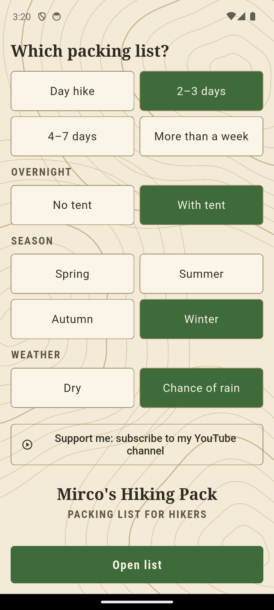
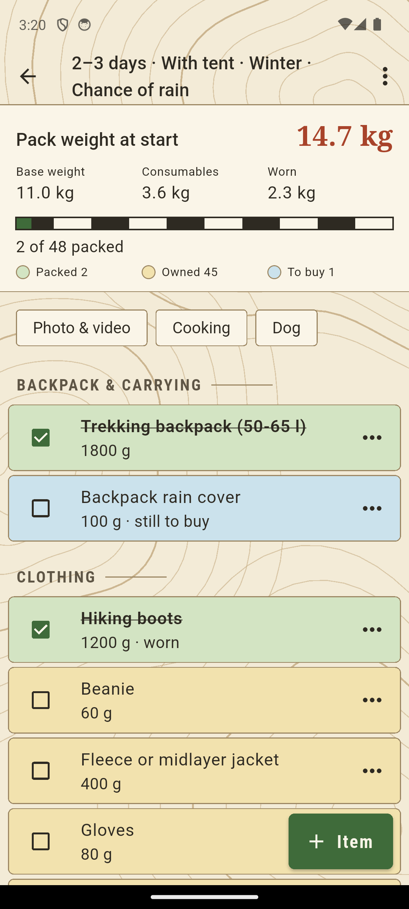
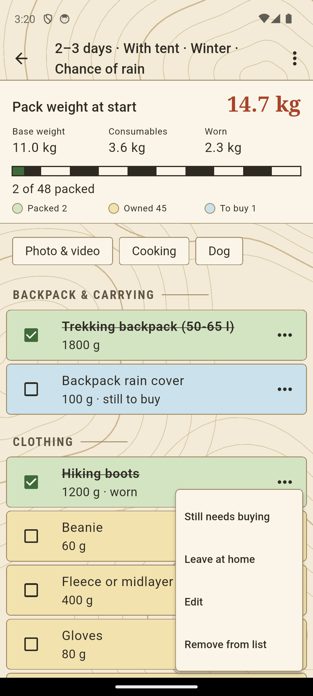
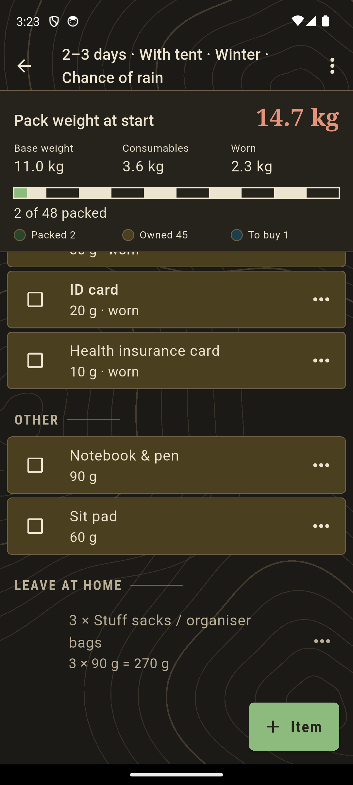

# Mirco's Hiking Pack

*German: Mircos Wanderrucksack*


An offline packing list for hikers. Pick the duration, tent or no tent, the season and the
weather, and you get one packing list with a weight overview. The list keeps your changes,
so the next autumn day hike in the rain starts exactly where you left off.

The app is in English or German, depending on the language of your phone.

| Choose conditions | Pack and track | Item actions | Dark mode |
|---|---|---|---|
|  |  |  |  |

## Features

- **One list per situation:** duration (day hike, 2–3 days, 4–7 days, more than a week),
  tent or no tent, season and weather. Every combination is its own list and remembers
  every change automatically.
- **Weight overview:** base weight, consumables, worn weight, and the pack weight at the
  start. Items without a weight are counted and shown, not hidden.
- **Packing status in colour:** green = packed, yellow = owned but not packed yet,
  light blue = still needs buying. Items you leave at home move to their own section and
  no longer count.
- **Extras as switches:** photo & video, cooking, dog, no power. Only the extras that change
  something for the current list are shown.
- **Your own weights:** change an item's weight once and it is used in every list.
- **Long trips:** for trips longer than a week, food is calculated for 3 days, assuming you
  resupply on the way.
- **Built for cold fingers:** large touch targets, at least 16 sp text in the list, no
  animations.

## Privacy

The app has **no internet permission**. There are no accounts, ads, analytics or crash
reporters. Your lists are stored in a single JSON file on the phone and never leave it.

## Install

1. Download the APK from the [Releases](../../releases) page.
2. Open it on your Android phone (Android 7.0 or newer). Android will ask once whether your
   file app may install apps. Allow it.
3. New versions install over the old one; your lists are kept.

## How it is built

Flutter app for Android, with the packing logic in a separate pure Dart package so it can be
reused in other apps without changes.

```
packages/packliste_core/   pure Dart, no Flutter import
  assets/items.json        74 items with default weights and inclusion rules (German)
  assets/items_en.json     English names
  lib/quantity.dart        small evaluator for quantity rules like "min(ceil(days/2), 3)"
  lib/generator.dart       builds the list from the rules
  lib/conditions.dart      maps duration, season and weather to rules
  lib/weights.dart         weight summary
lib/                       Flutter app (Riverpod), only calls the package
```

- **Rules instead of fixed lists:** every item has a rule (tour types, temperature bands,
  required extras, minimum days, quantity expression). The list is generated from these
  rules, so adding an item means adding one line of data.
- **Safe storage:** saving writes to a temporary file first and then renames it, so an
  interrupted save never leaves a broken file. If the file is unreadable anyway, the app
  starts empty with a message and keeps the old file as a backup.
- **Tests:** about 70 automated tests, including reference weights for fixed cases that were
  recalculated independently from the rules.

### Build from source

Requires Flutter (stable) and the Android SDK.

```
cd packages/packliste_core && dart test && cd ../..
flutter test
flutter build apk --release
```

Without a signing key the release build is signed with your local debug key. To sign with
your own key, copy `android/key.properties.example` to `android/key.properties` and fill it in.
Never commit that file or the key.

## How this app was made

I am not a professional developer. I defined the idea, the requirements, the rules and the
reference values, made the product decisions and tested the app. The code was written with
[Claude Code](https://claude.com/claude-code), an AI coding assistant, working from my
written specifications.

The original specification and the progress log are in
[docs/process](docs/process) (in German). They show how the app developed step by step.

## Limitations

- Android only, no iPhone version.
- Default weights are typical values, not measurements. Set your own weights for an honest
  total.
- Seasons map to fixed temperature bands (summer warm, spring and autumn mild, winter frost).
- There is no backup or export yet. Uninstalling the app deletes your lists.

## Support me

If you like the app, the best way to say thanks is to
**[subscribe to my YouTube channel](https://www.youtube.com/@mircoschroeder1)** about quiet
hikes in northern Germany. The app has a small link to it on the start screen. It opens your
browser or the YouTube app; the app itself still has no internet permission.

## License

[MIT](LICENSE) © 2026 Mirco Schröder
